# AI Agent for App Development

One prompt in, a runnable FastAPI + SQLite + static HTML/JS app out. Specialist agents (Planner, Backend, Frontend, Tester, Debugger) are orchestrated in a fixed pipeline with a verify/debug loop. The generated app lands in `workspace/<slug>/` with its own README, requirements, tests and `build_trace.json`.

## Setup
```bash
cd ./app-builder-agent
python3 -m venv .venv && .venv/bin/pip install -r requirements.txt
```
LLM: Grok CLI headless (default when `OPENAI_API_KEY` is unset), or an OpenAI-compatible API via `OPENAI_BASE_URL` (default `https://api.x.ai/v1`), `OPENAI_API_KEY`, `MODEL`; force with `LLM_PROVIDER` / `--provider`.

## Usage
```bash
.venv/bin/python -m builder.cli "a todo app with tags"            # live trace
.venv/bin/python -m builder.cli "a habit tracker" --brief         # JSON summary
.venv/bin/streamlit run app.py
.venv/bin/pytest -q                                               # offline, mocked LLM
cd workspace/<slug> && ../../.venv/bin/uvicorn app.main:app --port 8000   # run generated app
```

## Architecture

```mermaid
flowchart TD
  U[User prompt] --> P[Planner: JSON spec + endpoints + file plan]
  P --> B[Backend agent: app/main.py FastAPI + sqlite3]
  B --> F[Frontend agent: static/index.html vanilla JS]
  B --> T[Tester agent: tests/test_api.py TestClient]
  F & T --> V{Verify}
  V --> V1[pytest in sandbox: tmp dir, timeout, no network]
  V --> V2[HTTP smoke: uvicorn on free port, GET / + GET endpoints]
  V1 & V2 -->|fail| D[Debugger agent: patch files from failures + server log] --> V
  V1 & V2 -->|pass or max rounds| W[(workspace/slug + build_trace.json)]
```

All agents follow a shared **app contract** (in `builder/agents.py`): `APP_DB` env DB path, tables created at import, `/api/...` JSON routes, `/` serves the static page, and tests set `APP_DB` to a temp file. That contract is what makes the generated pieces fit together and be testable.


## Scope & Verification

- **Automated Tests**: `3 passed` via `pytest -q` verifying the multi-agent orchestration loop, sandbox test runner, and debugger retry flow against mocked LLM outputs.
- **Scope**: Prototype multi-agent code generator. Generated applications require review and security hardening before production deployment.
